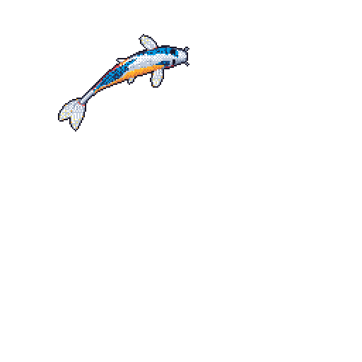

<div align="center">


<br/>


&nbsp;

&nbsp;


<br/><br/>

<a href="https://satwik23.vercel.app/">

</a>
&nbsp;
<a href="https://github.com/satwik88">

</a>
&nbsp;
<a href="https://www.linkedin.com/in/satwik-raj-35b6a9343/">

</a>
&nbsp;
<a href="mailto:raj0.0satwik@gmail.com">

</a>

<br/><br/>


</div>

---

##  &nbsp; ABOUT ME

I'm **Satwik Raj**, a Computer Science Engineering student passionate about building practical software and hardware solutions.

I enjoy working across multiple domains:

- Python Development
- Web Development
- IoT Systems
- Database Design
- Automation
- Open Source

**Currently exploring:**

- Artificial Intelligence
- Machine Learning
- Full Stack Development
- System Design
- DevOps

---

##  &nbsp; TECHNICAL SKILLS

### Languages

<p>

</p>

### Web Development

<p>

</p>

### Databases

<p>

</p>

### IoT & Hardware

<p>

</p>

### Development Tools

<p>

</p>

---

##  &nbsp; FEATURED PROJECTS

### 01 / THE GLOBAL GRID

A digital newspaper that follows the layout of a print edition, with a daily front page and a searchable archive. Readers can sign in with email or Google and save articles to read later.

**Features**

- Sections for World, Business, Technology, AI, Science, Culture, Travel and Opinion
- Article pagination and a searchable archive
- Email and Google sign-in
- Saved articles and bookmarks
- Profile with avatar, nickname and interests
- Downloadable PDF edition

**Technology Stack**

`Next.js` `React` `Tailwind CSS` `Prisma` `PostgreSQL` `NextAuth`

**Links**

[Live Website](https://the-global-grid.vercel.app/) · [Source Code](https://github.com/satwik88/The-Global-Grid)

---

### 02 / SMART DELIVERY SYSTEM

A logistics platform that uses classic DSA algorithms for delivery routing, resource allocation and network layout.

**Features**

- Dijkstra and Floyd-Warshall for routes
- Knapsack for load optimization
- Kruskal and Prim for network topology
- N-Queens
- Live order tracking
- Admin dashboard

**Technology Stack**

`React` `Node.js` `Express` `PostgreSQL` `Prisma`

**Links**

[Live Demo](https://smart-delivery-system-beta.vercel.app/) · [Source Code](https://github.com/satwik88/Smart-Delivery-System)

---

### 03 / INSUSENSE

A team project that predicts how likely a meal is to cause a post-meal glucose spike. You enter carbs, sugar, fiber, protein and fat, and it returns a Low, Medium or High risk, a 0 to 120 minute response curve and diet suggestions. I built the Streamlit interface, the prediction pipeline and the charts. For educational use only.

**Technology Stack**

`Python` `Streamlit` `scikit-learn` `Docker` `Render`

**Links**

[Live Demo](https://insusense.onrender.com/) · [Source Code](https://github.com/samm7dx/insusense)

---

### 04 / GRAPHISENSE

A computer vision mini project that analyzes handwriting to support dysgraphia screening. It runs two pipelines, a Random Forest on extracted handwriting features and a ResNet-18 CNN, and is evaluated on the Mendeley handwriting dataset. A Streamlit app wraps both.

**Technology Stack**

`Python` `OpenCV` `scikit-learn` `PyTorch` `Streamlit`

**Status**

In progress

---

### 05 / MONEY TRACKER

An Android expense tracker for my own daily use. Type an expense in plain words and it picks the category. Everything is stored on the phone, with no account and no server.

**Features**

- Balance card with income, spent and net totals
- Category pie chart and day, week and month stats
- PIN and fingerprint lock
- JSON export and import for backups

**Technology Stack**

`React` `Vite` `Capacitor` `Android`

**Links**

[Live App](https://github.com/satwik88/Expense_Tracker/releases) · [Source Code](https://github.com/satwik88/Expense_Tracker)

---

### 06 / AEROWATCH

An air quality dashboard built for my EVS assignment.

**Technology Stack**

`Next.js`

**Links**

[Live Website](https://aerowatch.vercel.app/) · [Source Code](https://github.com/satwik88/Aerowatch)

---

### 07 / SR DEV LAB

My portfolio website, with a Three.js background and a dark theme.

**Technology Stack**

`HTML` `CSS` `JavaScript` `Three.js`

**Links**

[Live Website](https://satwik23.vercel.app/) · [Source Code](https://github.com/satwik88/SR_DEV_LAB)

---

### 08 / FOOD ORDERING SYSTEM

A command-line food ordering app written in Python with MySQL.

**Features**

- User login
- Menu management
- Cart and order tracking
- MySQL storage
- Object-oriented design

**Technology Stack**

`Python` `MySQL` `OOP`

**Links**

[Source Code](https://github.com/satwik88/Food-Ordering-System)

---

##  &nbsp; CURRENTLY LEARNING

```yaml
Learning:
  - Machine Learning
  - Artificial Intelligence
  - React
  - Docker

Building:
  - Personal Projects
  - Portfolio Improvements
  - Automation Tools

Exploring:
  - Full Stack Development
  - Cloud Technologies
  - Open Source
```

---

##  &nbsp; GITHUB ANALYTICS

<div align="center">


<br/><br/>


</div>

---

##  &nbsp; GITHUB ACHIEVEMENTS

<div align="center">

<a href="https://github.com/satwik88?tab=achievements">

</a>

</div>

---

##  &nbsp; CONTRIBUTION ACTIVITY

<div align="center">


</div>

---

##  &nbsp; GITHUB KOI

<div align="center">



<br/>

*My GitHub activity, brought to life.*

</div>

---

##  &nbsp; CONNECT

<div align="center">

<a href="mailto:raj0.0satwik@gmail.com">

</a>
&nbsp;
<a href="https://github.com/satwik88">

</a>
&nbsp;
<a href="https://satwik23.vercel.app/">

</a>
&nbsp;
<a href="https://www.linkedin.com/in/satwik-raj-35b6a9343/">

</a>

<br/><br/>

**BUILDING THINGS THAT ACTUALLY WORK.**

*Driven by code. Defined by curiosity.*

<br/>


</div>
